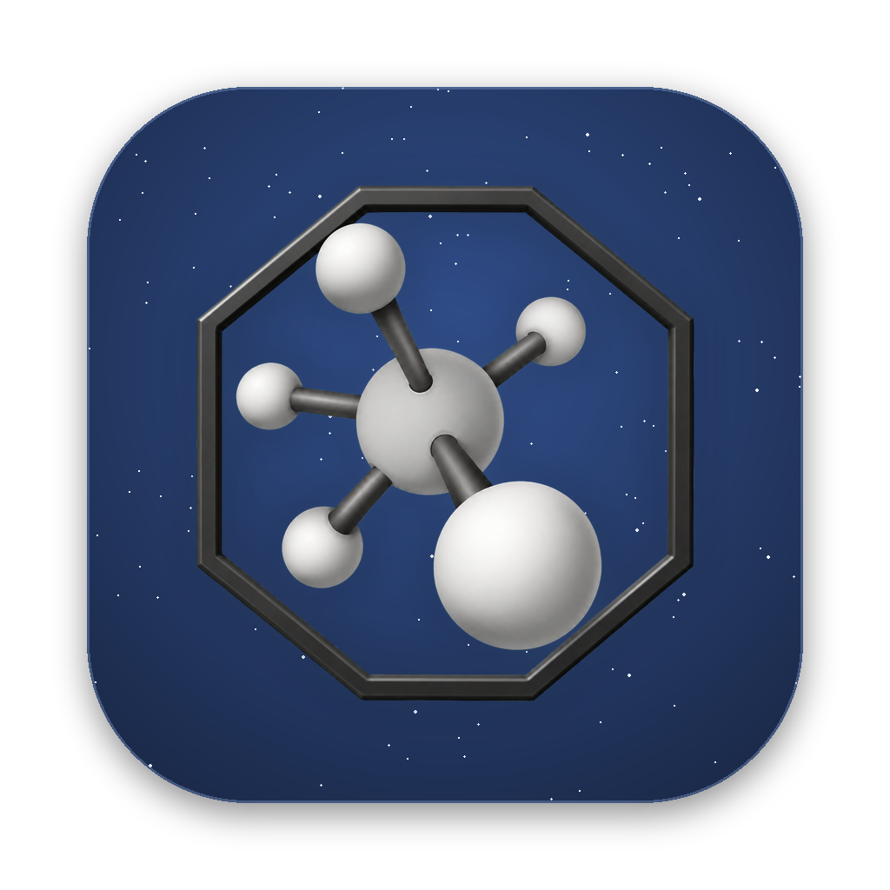

<p align="center"></p>

# EVE-O Preview for macOS

**English** | [简体中文](README.zh-CN.md) | [日本語](README.ja.md) | [한국어](README.ko.md) | [Русский](README.ru.md) | [Français](README.fr.md) | [Deutsch](README.de.md) | [Español](README.es.md)

EVE-O Preview for macOS shows a live thumbnail of every running EVE Online client. Click a thumbnail or press a global hotkey to switch to that client.

It is a native Swift re-implementation, for macOS, of the features of [EveOPlus/eve-o-preview](https://github.com/EveOPlus/eve-o-preview) (Windows, GPL-3.0). It does not port the upstream C# code, and its UI and configuration format differ from upstream.
It is licensed under the GNU General Public License version 3 or any later version (GPL-3.0-or-later), matching the SPDX identifiers in the source files; upstream is licensed under GPL-3.0. See [LICENSE](LICENSE) for the full text.

This repository started as a GitHub fork of EveOPlus/eve-o-preview and was moved to a standalone repository for v1.0. It is an independent project: it shares no code with the Windows version and is not maintained by the upstream authors.

## Features

- Client discovery: thumbnails update automatically when a client starts, exits, or is renamed after login.
- Live thumbnails: one ScreenCaptureKit stream per client, with adjustable size and frame rate.
- Thumbnail panels: they never take focus, appear on all Spaces, and can optionally stay on top. By default they have a 2-point light grey border so adjacent thumbnails are easy to tell apart; the color and width are adjustable, and the border can be turned off.
- Switching: left-click a thumbnail to switch to its client; Ctrl+click minimizes it. The right-click menu offers Minimize, Minimize All, Skip in Cycle, Hide This Thumbnail and Reset to Default Size.
- Overlays: character name title, a highlight border on the active client (color configurable per character; replaces the light grey border while shown), and a skip-in-cycle marker.
- Zoom on Hover (9 anchor points) and opacity.
- Visibility: hide the active client's thumbnail; hide when EVE is not in front (with a delay); hide per character; hide all.
- Layout: drag to move and resize, snapping to other thumbnails and screen edges, with an optional layout lock. Position and size are saved per character; clients on the login screen use a separate starting position.
- Cycle groups: forward and backward hotkeys, skip for the current session; per-character hotkeys; a hotkey to cycle through login-screen clients; Hide All and Minimize All hotkeys. Hotkeys can use the middle and side mouse buttons, and each hotkey can be global or EVE-only.
- Combat alerts (off by default): reads the game logs and flashes a character's thumbnail when that character is attacked.
- Profiles: create, clone, rename, delete and switch.
- Updates: checks GitHub for new releases and installs them from inside the app after verifying the download and its code signature (see [Updates](#updates)).
- Problem reports: builds a redacted diagnostics zip and opens a prefilled GitHub issue; after an unexpected quit, the next launch offers to report it (see [Reporting a problem](#reporting-a-problem)).
- A menu bar icon in place of the Windows tray icon.
- An 8-page settings window: Clients, Previews & Layout, Switching & Hotkeys, Alerts, Profiles, General, Permissions and About.
- UI languages: English (default), Chinese, Russian, Japanese, Korean, French, German and Spanish. Switch on the General page, or choose "Follow System"; the change takes effect immediately. The Russian, Japanese, Korean, French, German and Spanish translations are machine-generated; corrections are welcome.

## Upstream features not ported

| Upstream feature | Reason |
| --- | --- |
| Frame-rate limiting and selective muting (Robin injection) | Upstream injects a DLL into Windows processes; macOS has no equivalent public mechanism |
| CPU affinity | Relies on Windows CPU Sets; Apple Silicon has no public API to pin a process to cores |
| Combat log Augments: damage numbers, DPS, repair amounts, system overlay, FC static data | A large separate subsystem outside "preview and switch"; only "flash when attacked" was ported |
| Themes, legacy UI, custom right-click menu styles | The macOS version follows the system appearance |
| Compatibility capture mode (`PrintWindow`) | ScreenCaptureKit is the only capture method |
| Low-level keyboard hook | Keyboard hotkeys use Carbon global hotkeys; a mouse event tap is created only when a mouse button is bound |

Regions with drag-and-drop docking, multi-select and group moves, undo, snap guides, importing Windows configurations, and launch at login are planned for after v1.

## Requirements

- macOS 14 or later, on Apple Silicon or Intel. The release dmg contains a universal binary.
- EVE clients work best in windowed mode. Clients in native full screen are supported from 1.1.1 (thumbnails show over them while "Keep thumbnails on top" is on), but each lives in its own Space, so switching to one plays the Space transition animation.
- Building from source requires Xcode or the Command Line Tools (Swift 6).

## Installation

### Download a release

1. Download `EVE-O-Preview-<version>.dmg` from the [Releases](https://github.com/deletexiumu/eve-o-preview-macos/releases) page.
2. Open the dmg and drag `EVE-O Preview.app` into the Applications folder.
3. Open the app. Its icon appears in the menu bar, and on first launch the settings window opens on the Permissions page.

Release builds are signed with the project's own self-signed certificate and are not notarized, because the project has no Apple Developer ID. On first launch macOS blocks the app with a message that it cannot verify the developer. To open it:

1. Open System Settings > Privacy & Security.
2. Scroll down to the message about EVE-O Preview and click "Open Anyway", then confirm.

If macOS says the app "is damaged and can't be opened", or as an alternative to the steps above, remove the quarantine attribute in Terminal:

```sh
xattr -dr com.apple.quarantine "/Applications/EVE-O Preview.app"
```

**Note:** Every release is signed with the same certificate, so macOS keeps the Screen Recording and Accessibility permissions when you upgrade. If the permissions stop working after an upgrade, reset them with the `tccutil` commands at the end of [Permissions](#permissions) and grant them again.

Starting with 1.1.0 the app can update itself (see [Updates](#updates)). Version 1.0.0 has no updater, so install 1.1.0 by hand once: download the dmg and replace the app in Applications. The permissions are kept, because 1.0.0 and later are signed with the same certificate.

Each release also includes the source code as `.tar.gz` and `.zip`, and a `SHA256SUMS.txt` file. To verify the downloads, run `shasum -a 256 --ignore-missing -c SHA256SUMS.txt` in the download folder.

### Build from source

1. In the repository root, run `scripts/build-app.sh`. The script builds the release configuration, then assembles and signs `dist/EVE-O Preview.app`.
2. Drag `dist/EVE-O Preview.app` into the Applications folder.
3. Open the app.

The script reads these environment variables:

| Variable | Purpose | Default |
| --- | --- | --- |
| `VERSION` | Version number written into `Info.plist` | Contents of the `VERSION` file |
| `SIGN_IDENTITY` | Code signing identity | `EVEO Preview Dev` if it is in the keychain, otherwise ad-hoc (`-`) |
| `UNIVERSAL` | `1` builds arm64 and x86_64 separately and merges them with `lipo` into a universal binary | Unset: native architecture only |

If `packaging/AppIcon.png` exists, the script uses it to generate the app icon.

`scripts/package-release.sh` runs `build-app.sh`, then writes the dmg, the source archives and `SHA256SUMS.txt` to `dist/release/`. The CI uses this script.

## Permissions

The app uses the system permissions below, all granted in System Settings > Privacy & Security. The Permissions page of the settings window shows their status, with request buttons and links to System Settings.

| Permission | Used for | Without it |
| --- | --- | --- |
| Screen Recording | Capturing client windows and reading window titles | Thumbnails show a placeholder; without Accessibility as well, titles cannot be read and clients show as `EVE (PID)` |
| Accessibility | Restoring, raising and minimizing client windows, reading window titles, intercepting mouse hotkeys | Only the client process can be activated, so minimized windows cannot be restored; Minimize and Minimize All are disabled; mouse hotkeys do not work, keyboard hotkeys still do |
| Documents folder | Combat alerts read `~/Documents/EVE/logs/Gamelogs` | Requested only when combat alerts are turned on; if denied, the Alerts page shows the reason and other features are unaffected |

After you grant Screen Recording, the app usually has to restart for it to take effect; the Permissions page has a Relaunch button. Accessibility takes effect immediately.

### Sign with a self-signed certificate

macOS identifies an app by its code signature when it records permissions. An ad-hoc signature has no stable identity, so after every rebuild macOS treats the app as a different one and both permissions are lost. When you build it yourself, use a self-signed certificate:

1. Open Keychain Access and choose Keychain Access > Certificate Assistant > Create a Certificate.
2. Enter the name `EVEO Preview Dev`, set Identity Type to "Self-Signed Root" and Certificate Type to "Code Signing", then create it.
3. Run `scripts/build-app.sh`. The script uses this certificate automatically when it finds it in the keychain; you can also run `SIGN_IDENTITY="EVEO Preview Dev" scripts/build-app.sh`.
4. If macOS asks whether `codesign` may use the private key in the keychain, choose "Always Allow".

If the permission records get into a bad state, run these two commands and grant the permissions again:

```sh
tccutil reset ScreenCapture io.github.deletexiumu.eveopreview-macos
tccutil reset Accessibility io.github.deletexiumu.eveopreview-macos
```

## Usage

### Thumbnail gestures

A left mouse-down switches immediately without waiting for the release, so moving and resizing use a right-drag or an Option+left-drag.

| Action | Gesture |
| --- | --- |
| Switch to the client | Left mouse-down |
| Minimize the client | Ctrl+left mouse-down |
| Open the menu | Right-click (moving less than 4 points between press and release) |
| Move | Right-drag, or Option+left-drag |
| Resize | Same gesture as moving, starting within 12 points of the thumbnail edge |
| Temporarily disable snapping | Hold Shift while dragging; while resizing, Shift also keeps the aspect ratio |

With "Lock layout" turned on, moving and resizing do nothing; switching, minimizing and the menu still work.

### Hotkeys

Record hotkeys on the Switching & Hotkeys page of the settings window: click a button, then press a key combination or mouse button. Esc cancels and Delete clears. One action can have several bindings.

- Cycle groups: each group has forward and backward hotkeys that switch, in order, between the group's characters that are online and not skipped, wrapping around at the end.
- Per-character hotkeys: switch to that character's client.
- General hotkeys: show or hide all thumbnails, minimize all, and cycle through clients on the login screen.

Keyboard hotkeys should include Ctrl, Option or Command; F1–F20 and keypad digits can be used alone. System combinations such as Cmd+Tab, Cmd+Space and Cmd+Q are rejected. When a hotkey has a problem, the settings window shows the reason next to it.

Mouse hotkeys:

- The middle and side buttons can be recorded (written as `Mouse3`–`Mouse32` in the configuration), optionally with modifiers, such as `ctrl+Mouse4`. The left and right buttons cannot be bound.
- When a hotkey fires, that click (press, drag and release) is not passed to the front app, so a game action bound to the same button does not run.
- Mouse hotkeys require the Accessibility permission.

Scope:

- Each hotkey can be "Global" or "Only in EVE", written as the suffix `@global` or `@game` in the configuration. A hotkey without a suffix follows the profile's default scope.
- An "Only in EVE" hotkey works only while an EVE client is in front. In other apps the key press is passed to that app as usual.
- Newly recorded mouse hotkeys default to Only in EVE, so side buttons are not intercepted in every app.
- "Hotkeys Only in EVE" in the menu bar menu toggles the default scope.

### Combat alerts

Turn them on in the Alerts page of the settings window. The app then reads the game logs that clients write to `~/Documents/EVE/logs/Gamelogs`, maps each log to a character by the listener in the log header, and flashes a character's thumbnail border and image for 3 seconds when that character is attacked.

- The EVE client must have game logging enabled (it is by default).
- Misses also trigger an alert by default; this can be turned off. Minimum damage, flash color and duration are configurable.
- With "Hide thumbnails when EVE is not in front" turned on, an attacked character's thumbnail is shown temporarily.
- With "Reduce motion" turned on in System Settings, the flash is replaced by a steady highlight.
- The app only reads the logs. It never writes or modifies them, and sends no input to the game.
- The first time, macOS asks for access to the Documents folder. If your logs are elsewhere, choose the folder on the Alerts page.
- The Chinese client's log format has been checked against real logs. Japanese and Russian damage lines have been checked against real client logs (upstream's recorded samples); their miss lines are inferred from templates only. English, German, French, Spanish and Korean are inferred from upstream's templates and have not been checked against real logs.

### Menu bar

The menu bar icon matches the app icon: a molecule inside an octagon. The menu offers: Show or Hide All Thumbnails, switch profile, Minimize All, Hotkeys Only in EVE, Check for Updates…, Report a Problem…, Settings and Quit. When an update is available or the previous run quit unexpectedly, a dot appears on the icon and the menu gets an item for it at the top. When a permission is missing, the menu has an extra item about it. If you stop a client's capture from the system's recording indicator, the menu gains a "Resume Capture" item.

EVE-O Preview also shows its icon in the Dock; clicking it opens the settings window. To keep only the menu bar icon, clear "Show icon in Dock" under Settings > General.

### Updates

EVE-O Preview checks GitHub for a new release at launch and once a day. To turn this off, clear "Check for updates automatically" under Settings > General > Updates; "Check for Updates…" in the menu bar menu still checks on demand.

When a new version is available, a window shows the release notes in your interface language (English if there is no translation) and offers Install Update, Skip This Version and Later. While an EVE client is in front, the window waits until you switch away, and it never takes keyboard focus on its own; a dot on the menu bar icon shows that an update is waiting. "Skip This Version" only stops automatic reminders for that version; "Check for Updates…" still shows it.

Install Update downloads the dmg, checks it against `SHA256SUMS.txt`, verifies that the new app is signed with the same certificate as the running one, replaces the app and restarts it. If any step fails, the installed app is left unchanged. "Install updates automatically" is on by default: the update is downloaded in the background, then installed and the app restarted once no EVE client has been running for about a minute and no EVE-O Preview window is open. Otherwise it is installed when you quit EVE-O Preview, or when you choose "Restart to Update to X.Y.Z" in the menu bar menu. While an EVE client is running, the app never restarts by itself. Turn the setting off under Settings > General > Updates if you want the window to ask you first.

Some builds can only show the reason and an "Open Release Page" button instead of installing: ad-hoc or locally signed builds, an app running from a disk image or from a translocated location, an app in a folder you cannot write to, and an app on a volume that is not APFS, such as an external HFS+, exFAT or FAT disk.

### Reporting a problem

Choose "Report a Problem…" from the menu bar menu or the General page, or answer the prompt that appears after EVE-O Preview quit unexpectedly. The window lists every file that will go into the report and shows its contents after redaction: an environment summary, a settings summary without any names, the app log (up to 2 MiB) and up to three macOS crash reports. Nothing is created until you click "Create Report Only" or "Create Report and Open GitHub". The zip is saved to `~/Library/Application Support/EVE-O Preview/Reports/` (the 3 newest are kept) and Finder shows it; "Create Report and Open GitHub" also opens a prefilled issue in your browser. You attach the zip yourself; the app never uploads anything.

Your macOS user name, full name, home folder path and computer names are replaced with `[user]` and `[host]`. EVE character names become `[character-1]`, `[character-2]` and so on, and crash-report device identifiers become `[redacted]`. Only names the app knows are replaced: characters that never appeared in your settings or as a running client are not. If a name is a common word, the same word elsewhere in the log is replaced too. You can read every file before creating the report and untick any file you don't want to include.

The app keeps up to 5 log files of 1 MiB each in `~/Library/Logs/EVE-O Preview/`. Character names and window titles are written as `<private>`. Turn on "Verbose logging" in General to also record debug lines; "Show Logs in Finder" opens the folder. If no prompt appears after a crash, attach `~/Library/Logs/DiagnosticReports/EVEOPreview-<date>.ips` to the issue by hand.

## Privacy

Version 1.0.0 made no network requests. From 1.1.0 the app connects only to GitHub, and only for updates:

- Checking for updates requests `api.github.com/repos/deletexiumu/eve-o-preview-macos/releases/latest` at launch and once a day while "Check for updates automatically" is on, and whenever you choose "Check for Updates…".
- Installing an update downloads `SHA256SUMS.txt` and the dmg from the release.

The requests carry only the app version in the `User-Agent` header, a fixed `Accept-Language: en` and a cache tag; no character names, settings, logs, hardware details, system version or identifiers are sent, and no cookies are used. GitHub sees your IP address and the time of the request. There is no telemetry and no automatic crash upload: "Report a Problem…" only creates a zip on your Mac and opens a web page that you choose whether to submit.

The app stores data in these places. To uninstall completely, delete them along with the app and `~/Library/Application Support/EVE-O Preview/config.json`:

| Location | Contents |
| --- | --- |
| `~/Library/Logs/EVE-O Preview/` | App logs, about 5 MiB at most |
| `~/Library/Application Support/EVE-O Preview/session.json`, `state.json` | Session marker; update and diagnostics records |
| `~/Library/Application Support/EVE-O Preview/Reports/` | Problem report zips you created, redacted (the 3 newest) |
| `~/Library/Caches/io.github.deletexiumu.eveopreview-macos/Updates/` | Downloaded update files, deleted after installing |

## Configuration file

The configuration is saved in `~/Library/Application Support/EVE-O Preview/config.json`. One file holds all profiles.

- Changes are saved automatically 0.5 seconds after you make them, and once more on quit.
- If the file is corrupt, it is renamed to `config.corrupt-<date-time>.json` and the app uses the default configuration.
- If the file comes from a newer version, the app runs with the default configuration, does not write to disk during that session, and does not overwrite the file.

The Profiles page has a "Show in Finder" button.

## Development

| Command | Purpose |
| --- | --- |
| `swift build` | Build all targets |
| `swift test` | Run the Core unit tests (swift-testing) |
| `EVEO_FAKE=1 swift run EVEOPreview` | Demo mode: 3 fake clients with generated animated images, needing neither EVE nor any permission |
| `python3 scripts/check_quality.py` | Check comment ratio, file length and function length |
| `scripts/build-app.sh` | Assemble and sign the `.app` |
| `scripts/package-release.sh` | Build the dmg, source archives and checksums in `dist/release/` |
| `swift run EVEOProbe gamelog [dir] [--follow seconds]` | Count each kind of combat line in the game logs, to diagnose combat alerts |
| `swift run EVEOProbe mousetap <seconds> [--swallow <button>]` | Print mouse button numbers, to diagnose mouse hotkeys |
| `swift run EVEOProbe update feed [url]` | Fetch and parse the release feed |
| `swift run EVEOProbe update verify <new app> <base app>` | Check whether a new app satisfies the base app's designated requirement |
| `swift run EVEOProbe update prepare <url> [--cache dir]` | Download and verify an update without installing it |
| `scripts/make-update-test-feed.sh [version]` | Write a `feed.json` for a local update test from `dist/release/` |

Demo mode writes its configuration to `config-fake.json` in the same folder, leaving the real configuration untouched. These environment variables help with debugging:

| Variable | Purpose |
| --- | --- |
| `EVEO_CONFIG_PATH` | Use the given configuration file |
| `EVEO_LANG` | `en`, `zh`, `ru`, `ja`, `ko`, `fr`, `de` or `es`; overrides the UI language in the configuration |
| `EVEO_FAKE_DENY` | In demo mode, pretend a permission is missing: `screen`, `ax` or `screen,ax` |
| `EVEO_FAKE_STOP_AFTER` | In demo mode, pretend the user stopped the second client's capture after this many seconds |
| `EVEO_SETTINGS_PAGE` | Open a settings page directly on launch, such as `previews` |
| `EVEO_LOG_DIR` | Write the log files to another folder (default `~/Library/Logs/EVE-O Preview/`) |
| `EVEO_STATE_DIR` | Keep `state.json` and `session.json` in another folder |
| `EVEO_LOG_PRIVATE` | `1` shows private values in the system log (Console) only; log files always contain `<private>` |
| `EVEO_UPDATE_FEED_URL` | Check this address for updates instead of GitHub; only `https` or `http` on a loopback host. Builds signed with a local certificate may install from it; the signature check is not relaxed |
| `EVEO_UPDATE_UI_STATE` | In demo mode, show the update UI in a sample state: `available`, `notifyonly`, `downloading`, `ready`, `failed` or `uptodate` |
| `EVEO_FAKE_CRASH` | `1` in demo mode pretends the previous run crashed, to show the crash report prompt |

The source has 3 modules: `EVEOPreviewCore` is the pure logic layer, `EVEOPreviewPlatform` wraps AppKit, ScreenCaptureKit, Accessibility and Carbon hotkeys, and `EVEOPreview` is the app itself. The architecture is described in [docs/architecture.md](docs/architecture.md) (in Chinese).

**Note:** When you run the executable directly with `swift run`, macOS records permissions under your terminal app, not under `EVE-O Preview.app`.

### CI and releases

`.github/workflows/build.yml` runs on GitHub-hosted macOS runners:

- Every pull request to `main`, and every push to `main`, runs the quality gate and the unit tests, then builds a universal dmg and the source archives. They are uploaded as a workflow artifact named `EVE-O-Preview-<version>-pr.<number>.<commit>` (or `-dev.<commit>` for pushes) and kept for 30 days.
- Pushing a `v*` tag builds the same files and publishes them as a GitHub Release. The tag must match the `VERSION` file. If `docs/release-notes/<tag>.md` exists, it becomes the release notes.

To release a new version, change the `VERSION` file and add `docs/release-notes/v<version>.md` in a pull request, merge it, then tag `main`: `git tag v<version> && git push origin v<version>`.

The asset names (`EVE-O-Preview-<version>.dmg`, `SHA256SUMS.txt`), the dmg layout, the signing certificate and the release-notes format are a contract with the in-app updater; CI checks them on every build. Release notes put English first between `<!-- lang:en -->` and `<!-- /lang:en -->`, followed by collapsible zh, ja, ko and ru blocks marked the same way; `scripts/check_release_notes.py` checks the markers. Details are in sections 9.5 to 9.7 of [docs/architecture.md](docs/architecture.md).

## Disclaimer

This tool only switches window focus. It does not broadcast input to multiple clients and does not read or modify game memory, the same boundary as upstream. Read the EVE Online End User License Agreement before using it.

The app connects to GitHub only to check for and download updates, and sends no personal data (see [Privacy](#privacy)).

EVE Online and related logos are trademarks of CCP ehf. This project is not affiliated with or endorsed by CCP.

The app icon reuses the molecule icon of upstream EveOPlus/eve-o-preview (GPL-3.0). The background is drawn by `scripts/make-app-icon.py` and contains no CCP trademarks or game art.
